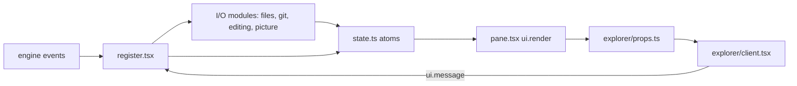

# Architecture

STRACKZDEVHUB is a Claude Code mod: one hooks module (`hooks/register.tsx`, named in `hooks/hooks.json`) that the engine loads into an environment of its own, with no DOM and no Node. Everything outside that environment (files, git, the session, drawing) is reached through `$`, the engine interface each hook receives.

## How a frame comes to be



1. **Events in.** `register.tsx` hooks the engine's events (`session.start`, `turn.*`, `tool.call`, `agent.spawn`, `command.run`, `ui.message`) and hands each to the module that does the work.
2. **State.** Every value the pane shows lives in an atom in `hooks/state.ts` (`vitals`, `explorer`, `touched`, `agents`, `activity`, `gitTick`). Writing an atom redraws whatever read it. The atoms' types are the contract in `types/index.d.ts`.
3. **Drawing.** `pane.tsx` answers `ui.render` for the pane: it reads the atoms and draws three boxes (session, agents, files). It does no I/O.
4. **The explorer client.** The file box's body is a client module, `explorer/client.tsx`, that runs on the drawing surface. It draws the props `explorer/props.ts` built and posts keys and clicks back as a typed `UiMessage`. It holds no explorer state of its own.
5. **Keys back in.** `ui.message` reaches `register.tsx`, which runs the pure reducer (`explorer/model.ts` `reduceKey`, or `explorer/editor/editor.ts` `reduceEdit` while editing), writes the next state, and performs the effect the reducer asked for (open, go up, save, mention).

A 3-second timer (`files.ts` `poll`) refreshes the folder listing, git status and the open file while the pane is open.

## Pure core, thin I/O shell

Modules are one of two kinds, and the file header says which:

| Kind | Rule | Tested by |
| --- | --- | --- |
| **Pure** (`// Pure logic for STRACKZDEVHUB: …`) | no `$`, no atoms, no I/O; data in, data out | a unit test in the mirrored `tests/` folder |
| **I/O** | talks to the engine through `$`; decides as little as possible | `tests/pane.test.ts`, end to end with the engine mocked |

New behaviour goes in a pure function first; the I/O module calls it.

## Module map

```
hooks/
  hooks.json            names the hooks module
  register.tsx          wiring: engine events and /strackzdevhub → the modules below
  state.ts              the atoms, and every read and update of one
  pane.tsx              ui.render for the pane: session, agents, files
  elapsed.tsx           client module: a timer that ticks without redrawing the pane

  session/vitals.ts     pure: default vitals, a usage report → vitals, the context alarm level, the turn history
  agents/agents.ts      pure: tool descriptions, step usage, agent defaults
  shared/format.ts      pure: money, tokens, sizes, times, models, clipping, clamp, sparklines
  shared/paths.ts       pure: join, parent, base name, relative, Windows separators

  explorer/
    client.tsx          client module: draws the list or the file, posts UiMessage
    props.ts            pure: the props the client draws, from the state
    model.ts            pure: defaults, sorting, visible rows, the preview, the key reducer, line picks and mentions
    header.ts           pure: fitting the header and breadcrumb to the width
    files.ts            I/O: listings, opening a file, the live refresh, Claude's edits
    editor/editor.ts    pure: keys against the text, cursor, tabs
    editor/editing.ts   I/O: enter, leave, save, undo
    git/gitdiff.ts      pure: line diff, the diff view's hunks, porcelain and branch parsing
    git/git.ts          I/O: git status, the gutter's base (HEAD and index)
    media/media.ts      pure: markdown windows, PNG sizes, picture fitting
    media/picture.ts    I/O: PNG as is, other formats converted by ImageMagick or ffmpeg

types/index.d.ts        the $.state contract (one file, see ADR 0004)
tests/                  mirrors hooks/; pane.test.ts runs the whole mod against a mocked engine
```

## Module caches

Some I/O modules keep caches in module variables: undo history and saved text (`state.ts`), git bases (`git/git.ts`), the picture converter and cache folder (`media/picture.ts`). The engine starts them over on every reload; anything that has to survive a reload belongs in an atom.

## Decisions

The reasons behind the shape are in [`docs/adr/`](adr/):

- [0001](adr/0001-feature-folders.md): folders by feature
- [0002](adr/0002-pure-core-io-shell.md): pure core, thin I/O shell
- [0003](adr/0003-state-in-one-file.md): every atom read and written in `state.ts`
- [0004](adr/0004-single-types-contract.md): one self-contained types contract
- [0005](adr/0005-slash-paths.md): `/` paths inside, converted where they come in
- [0006](adr/0006-touched-follows-git.md): touched follows `git status` inside a repository
